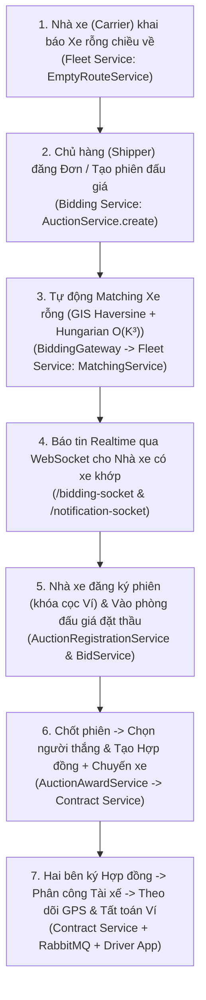

# 🚛 BackhaulBid — Nền tảng Đấu giá Vận tải & Ghép nối Xe tải Rỗng Chiều về

**BackhaulBid** là hệ thống sàn giao dịch và đấu giá vận tải hàng hóa (Reverse Auction Logistics Marketplace), tập trung giải quyết bài toán **tối ưu hóa xe tải chạy rỗng chiều về (Backhaul)**.

Hệ thống cho phép **Chủ hàng (Shipper)** đăng đơn vận chuyển dưới dạng phiên đấu giá ngược (Công khai hoặc Bỏ thầu kín), tự động tìm kiếm và ghép cặp (**Optimal Bipartite Matching — Hungarian Algorithm $O(K^3)$**) với các **Nhà xe (Carrier)** có lộ trình xe rỗng phù hợp, thông báo thời gian thực qua WebSocket, tự động khóa/giải tỏa tiền cọc qua Ví điện tử, ký kết Hợp đồng điện tử và theo dõi vị trí GPS chuyến xe trực tuyến.

---

## 📂 1. Cấu trúc các Phân hệ (Repositories)

Dự án được tổ chức gồm **5 phân hệ chính**:

| Thư mục | Công nghệ chính | Vai trò trong hệ thống |
| :--- | :--- | :--- |
| **[`backhaulbid-infrastructure`](./backhaulbid-infrastructure)** | Spring Cloud Gateway, Netflix Eureka, Docker Compose, PostgreSQL, MongoDB, Redis, RabbitMQ | Cổng giao tiếp trung tâm (**API Gateway** `:8080`), **Service Discovery (Eureka** `:8761`) và cấu hình [`docker-compose.yml`](./backhaulbid-infrastructure/docker-compose.yml) điều phối toàn bộ hạ tầng. |
| **[`backhaulbid-core-services`](./backhaulbid-core-services)** | Java 21, Spring Boot 3, Spring Data JPA, PostgreSQL, Flyway, RabbitMQ | Cụm **5 Microservices cốt lõi** xử lý nghiệp vụ có tính toàn vẹn dữ liệu cao: `identity-service`, `fleet-service`, `wallet-service`, `contract-service`, `media-service`. |
| **[`backhaulbid-node-services`](./backhaulbid-node-services)** | Node.js, NestJS (Monorepo), Mongoose (MongoDB), Socket.IO, RabbitMQ | Cụm **2 Microservices thời gian thực**: Phòng đấu giá (`apps/bidding` `:3001`) và Thông báo & luồng GPS (`apps/notification` `:3002`). |
| **[`backhaulbid-web-portal`](./backhaulbid-web-portal)** | Next.js (App Router), React, Material UI (MUI), Leaflet Map, Socket.IO Client | Cổng giao diện Web dành cho **Shipper** (Chủ hàng), **Carrier** (Nhà xe) và **Admin** (Quản trị viên). |
| **[`backhaulbid-driver-app`](./backhaulbid-driver-app)** | React Native (Expo), NFC/Camera eKYC, Realtime GPS Location | Ứng dụng di động dành cho **Tài xế (Driver)** nhận chuyến, cập nhật hành trình GPS, chụp ảnh bàn giao hàng hóa và cho Shipper/Carrier thao tác trên thiết bị di động. |

---

## 🏗️ 2. Kiến trúc Microservices chi tiết

### A. Cụm Core Services (`backhaulbid-core-services` — Spring Boot + PostgreSQL)
1. **`identity-service`** ([`backhaulbid-core-services/identity-service`](./backhaulbid-core-services/identity-service)):
   - Quản lý tài khoản, xác thực JWT, phân quyền (`SHIPPER`, `CARRIER`, `DRIVER`, `ADMIN`) và sổ địa chỉ.
   - Xác thực danh tính điện tử **eKYC** (quét NFC/OCR CCCD + so khớp khuôn mặt), duyệt giấy phép kinh doanh và chứng nhận bảo hiểm trách nhiệm hàng hóa.
2. **`fleet-service`** ([`backhaulbid-core-services/fleet-service`](./backhaulbid-core-services/fleet-service)):
   - Quản lý đội xe (`Vehicle`), hồ sơ tài xế (`DriverProfile`), điểm uy tín nhà xe (`CarrierReputation`).
   - Quản lý đăng ký **chuyến xe rỗng chiều về** (`EmptyRoute`) và thực thi **Thuật toán ghép cặp tối ưu Hungarian (Kuhn-Munkres $O(K^3)$)** kết hợp khoảng cách địa lý Haversine GIS ([`MatchingService.java`](./backhaulbid-core-services/fleet-service/src/main/java/iuh/fit/se/fleetservice/service/MatchingService.java), [`EmptyRouteService.java`](./backhaulbid-core-services/fleet-service/src/main/java/iuh/fit/se/fleetservice/service/EmptyRouteService.java)).
3. **`wallet-service`** ([`backhaulbid-core-services/wallet-service`](./backhaulbid-core-services/wallet-service)):
   - Quản lý số dư ví điện tử, tích hợp cổng thanh toán **SePay** để nạp/rút tiền.
   - Cung cấp cơ chế `hold` (tạm giữ), `release` (hoàn trả cọc), `forfeit` (khấu trừ) và `refund` (hoàn tiền) có chống trùng lặp (`idempotencyKey`) cho phí tạo phiên, phí tham gia và tiền đặt cọc.
4. **`contract-service`** ([`backhaulbid-core-services/contract-service`](./backhaulbid-core-services/contract-service)):
   - Tự động khởi tạo **Hợp đồng vận chuyển (`Contract`)** và **Chuyến xe (`Trip`)** khi phiên đấu giá kết thúc.
   - Quản lý quy trình ký hợp đồng 2 bên (Carrier ký trước, Shipper ký sau trong hạn 24h), gán tài xế bằng mã nhận chuyến, biên bản bàn giao hàng (`Handover`), phát sự kiện tọa độ GPS qua RabbitMQ và xử lý khiếu nại/đền bù bảo hiểm (`Complaint`, `InsuranceClaim`).
5. **`media-service`** ([`backhaulbid-core-services/media-service`](./backhaulbid-core-services/media-service)):
   - Quản lý tải lên và truy xuất an toàn ảnh lô hàng, chứng từ giá trị hàng hóa và bằng chứng bàn giao/khiếu nại trên S3.

### B. Cụm Node Services (`backhaulbid-node-services` — NestJS + MongoDB + Socket.IO)
1. **`bidding-service`** ([`backhaulbid-node-services/apps/bidding`](./backhaulbid-node-services/apps/bidding/src)):
   - **Order / Auction Module** ([`auction.service.ts`](./backhaulbid-node-services/apps/bidding/src/modules/auction/auction.service.ts)): Cho phép Shipper đăng đơn vận chuyển kiêm phiên đấu giá (`PUBLIC` hoặc `SEALED`), kiểm tra eKYC, kiểm tra hồ sơ giá trị hàng hóa và thu phí tạo phiên.
   - **Registration & Bid Module** ([`auction-registration.service.ts`](./backhaulbid-node-services/apps/bidding/src/modules/auction-registration/auction-registration.service.ts), [`bid.service.ts`](./backhaulbid-node-services/apps/bidding/src/modules/bid/bid.service.ts)): Quản lý nhà xe đăng ký vào phòng (khóa tiền cọc & phí tham gia) và đặt giá thầu với cơ chế khóa đồng bộ theo từng phiên (`withAuctionLock`) chống race-condition.
   - **Realtime Bidding Gateway** ([`bidding.gateway.ts`](./backhaulbid-node-services/apps/bidding/src/modules/bidding/bidding.gateway.ts)): Cổng WebSocket `/bidding-socket` phát trực tiếp giá thầu mới (`bidPlaced`), trạng thái phòng (`auctionStatusChanged`) và thông báo khớp xe rỗng (`new_matching_order`).
   - **Award Service** ([`auction-award.service.ts`](./backhaulbid-node-services/apps/bidding/src/modules/auction/auction-award.service.ts)): Tự động chọn người thắng thầu, gọi `contract-service` tạo hợp đồng và tự động đôn tối đa 3 nhà xe dự phòng nếu nhà xe thắng thầu không ký hợp đồng đúng hạn.
2. **`notification-service`** ([`backhaulbid-node-services/apps/notification`](./backhaulbid-node-services/apps/notification/src)):
   - Quản lý thông báo người dùng và phát sự kiện thời gian thực qua WebSocket `/notification-socket` ([`notification.gateway.ts`](./backhaulbid-node-services/apps/notification/src/modules/notification/notification.gateway.ts)).
   - Lắng nghe hàng đợi RabbitMQ (`trip.location.updated`) từ `contract-service` để truyền trực tiếp vị trí GPS của tài xế lên bản đồ theo dõi của Shipper và Carrier ([`trip-location.consumer.ts`](./backhaulbid-node-services/apps/notification/src/modules/notification/trip-location.consumer.ts)).

---

## 🔄 3. Luồng hoạt động từ A–Z (End-to-End Workflow)



### 🧭 Bản đồ đọc code nhanh theo chức năng:
- **Shipper đăng đơn & tạo phiên đấu giá:**
  - Frontend Web: [`CreateAuctionScreen.jsx`](./backhaulbid-web-portal/src/components/shipper/create-auction/CreateAuctionScreen.jsx)
  - Backend: [`auction.controller.ts`](./backhaulbid-node-services/apps/bidding/src/modules/auction/auction.controller.ts) → [`auction.service.ts`](./backhaulbid-node-services/apps/bidding/src/modules/auction/auction.service.ts)
- **Thuật toán Ghép cặp Xe rỗng (GIS + Hungarian Algorithm $O(K^3)$):**
  - Backend: [`EmptyRouteService.java`](./backhaulbid-core-services/fleet-service/src/main/java/iuh/fit/se/fleetservice/service/EmptyRouteService.java) → [`MatchingService.java`](./backhaulbid-core-services/fleet-service/src/main/java/iuh/fit/se/fleetservice/service/MatchingService.java)
  - Giao diện Nhà xe nhận thông báo khớp lệnh: [`FleetManagerDashboard.tsx`](./backhaulbid-web-portal/src/components/fleet-manager/FleetManagerDashboard.tsx)
- **Phòng đấu giá thời gian thực (Realtime Bidding Room):**
  - Frontend Web: [`CarrierAuctionScreen.jsx`](./backhaulbid-web-portal/src/components/carrier/auction-detail/CarrierAuctionScreen.jsx) & [`useAuctionSocket.js`](./backhaulbid-web-portal/src/hooks/useAuctionSocket.js)
  - Mobile App: [`CarrierAuctionRoom.jsx`](./backhaulbid-driver-app/components/auctions/CarrierAuctionRoom.jsx)
  - Backend: [`bidding.gateway.ts`](./backhaulbid-node-services/apps/bidding/src/modules/bidding/bidding.gateway.ts) → [`bid.service.ts`](./backhaulbid-node-services/apps/bidding/src/modules/bid/bid.service.ts)
- **Trao thầu, Hợp đồng & Theo dõi hành trình GPS:**
  - Trao thầu tự động: [`auction-award.service.ts`](./backhaulbid-node-services/apps/bidding/src/modules/auction/auction-award.service.ts)
  - Nhận luồng GPS qua RabbitMQ & phát Socket: [`trip-location.consumer.ts`](./backhaulbid-node-services/apps/notification/src/modules/notification/trip-location.consumer.ts) → [`useTripLocationStream.js`](./backhaulbid-web-portal/src/components/tracking/useTripLocationStream.js)

---

## 🚀 4. Hướng dẫn khởi chạy hệ thống (Docker Compose)

1. Di chuyển vào thư mục `backhaulbid-infrastructure`:
   ```bash
   cd backhaulbid-infrastructure
   cp .env.example .env
   ```
2. Khởi chạy toàn bộ hạ tầng và các microservices bằng Docker Compose:
   ```bash
   docker compose up -d --build
   ```
3. Các cổng dịch vụ chính:
   - **Web Portal (Giao diện người dùng):** `http://localhost:3000`
   - **API Gateway (Cổng API & WebSocket trung tâm):** `http://localhost:8080`
   - **Eureka Server (Quản lý tiến trình Microservices):** `http://localhost:8761`
   - **RabbitMQ Management:** `http://localhost:15672`
